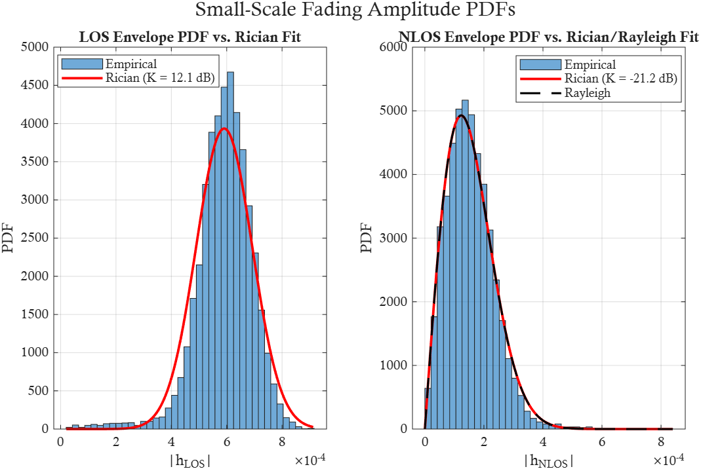
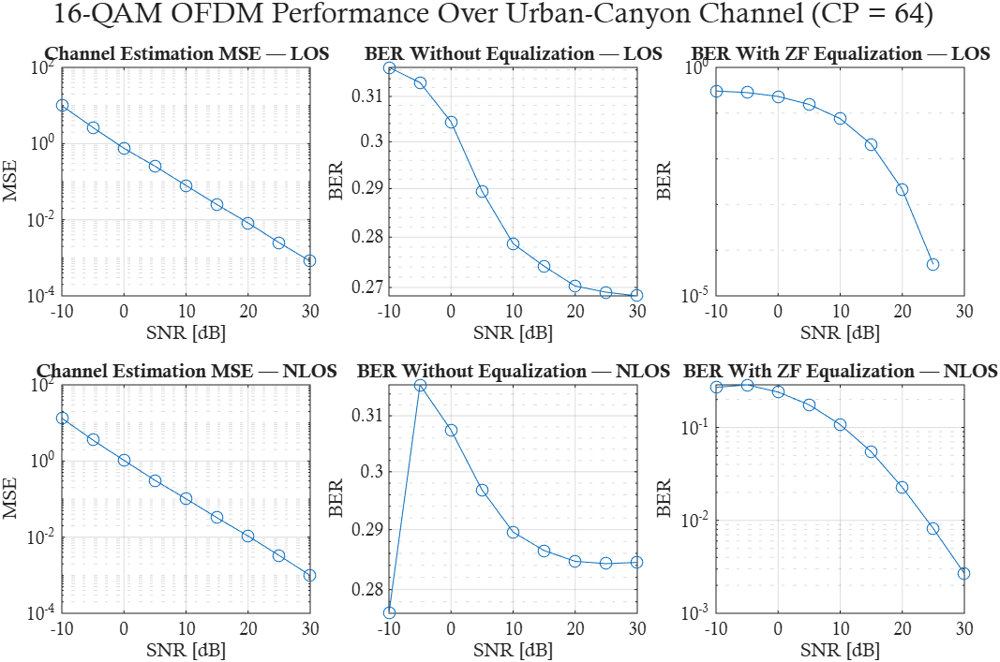
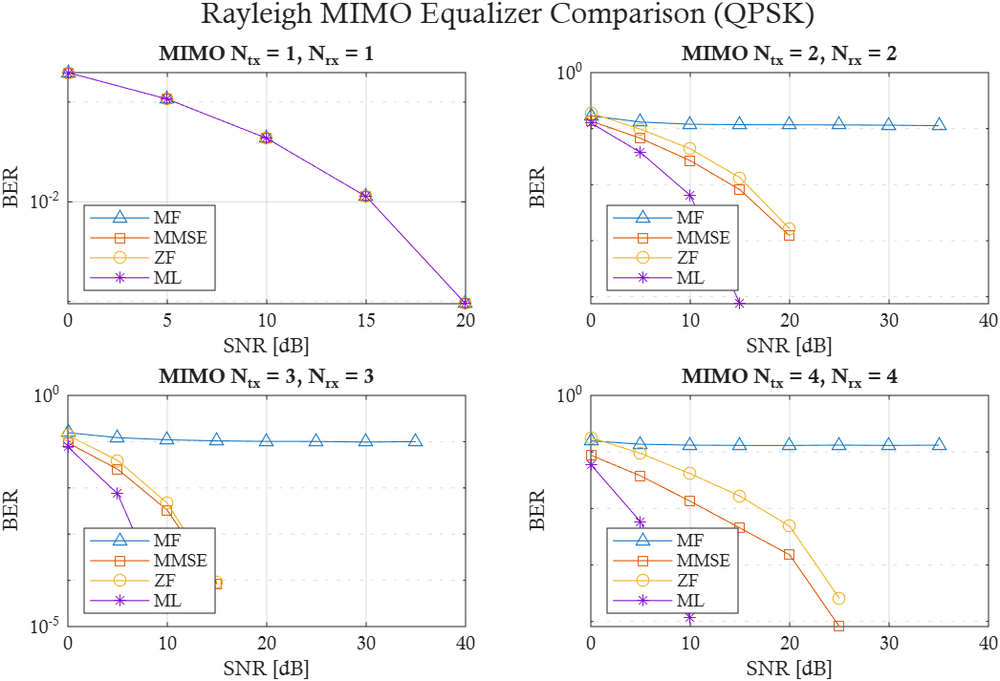

# Wireless Propagation, MIMO & Wideband OFDM Simulator

A MATLAB simulation suite (`ELEC-H422 / H423`) covering **3.6 GHz urban street-canyon wideband & narrowband channel characterization**, **end-to-end 1024-subcarrier 16-QAM OFDM transmission with Schmidl-Cox synchronization**, and **Rayleigh MIMO spatial-multiplexing equalizers (`MF`, `ZF`, `MMSE`, `ML`) and diversity combining (`MRC`, `MRT`)**.

> [!NOTE]
> The obfuscated course propagation binaries in `functions/*.p` are retained so the urban-canyon and OFDM scripts run directly out-of-the-box. As documented in [LICENSE](LICENSE), those proprietary binaries are **excluded** from the MIT License covering all original `.m` code.

## Modules & Verified Results

1. **Wideband Urban-Canyon Channel (`src/propagation/session1_wideband_channel.m`)**
   - Sweeps bandwidths `B = [1, 10, 100] MHz` and wall reflections `rho = [0, 2, 10]` at `3.6 GHz` (`walls y = ±8 m`), extracting CTFs, coherence bandwidth (`0.7` correlation threshold: `[1.00, 10.00, 7.62] MHz` LOS @ `rho = 10`), normalized CIRs, PDPs, and RMS delay spread `sigma_tau` (`[2355.1, 304.8, 84.6] ns` LOS @ `rho = 10`).
2. **Narrowband Local-Area Fading & Angular Spread (`src/propagation/session4_narrowband_fading.m`)**
   - Maps spatial amplitude fading (`3.575` vs. `3.625 GHz`), fits Rician/Rayleigh **PDF & CDF** distributions (`K_los = 16.23` / `12.10 dB`, `K_nlos = 0.0075` / `-21.24 dB`), measures `0.75`-threshold spatial coherence distances (`x: 0.99 m LOS / 0.01 m NLOS`, `y: 0.97 m LOS / 0.01 m NLOS`), and computes Power Angular Spectra (PAS).
3. **1024-SC 16-QAM OFDM Transceiver (`src/ofdm/session2_3_ofdm_transceiver.m`)**
   - Simulates `CP = 64` OFDM bursts with a repeated two-block training preamble, sliding autocorrelation ToA synchronization (`BerSimulation_autoCorr.m`), preamble LS channel estimation, and single-tap ZF equalization across `SNR = -10..30 dB`:
     - **LOS Equalized BER:** `0.3047` (`-10 dB`) -> `2.14e-3` (`20 dB`) -> `4.88e-5` (`25 dB`) -> `0` (`30 dB`)
     - **LOS CTF MSE:** `9.870 -> 8.13e-4`
4. **Urban-Canyon SVD & Rayleigh MIMO (`src/mimo/`)**
   - **`session5a_mimo_channel_svd.m`:** Rank-1 dominant eigenmodes for `1x4` Y/X canyon arrays (`S1(1,1) = 3.302` Y-LOS, `S_los(1,1) = 3.897` X-LOS).
   - **`session5b_mimo_equalizers_rayleigh.m`:** Compares `MF`, `ZF`, `MMSE`, and exhaustive `ML` for `1x1..4x4` Rayleigh QPSK (`4x4` BER @ `20 dB`: `1.30e-1` MF, `4.84e-3` ZF, `1.51e-3` MMSE, `0` ML).
   - **`session5c_mimo_diversity_mrc_mrt.m`:** Verifies `1xN` SIMO MRC vs. `Nx1` MISO MRT diversity across `N = 1..4` (`@ 14 dB` MRC BER: `1.57e-2`, `1.41e-3`, `6.45e-5`, `0` vs. AWGN `2.68e-7`).
   - *Runtime note:* `session5b` and `session5c` ship with fast default Monte Carlo counts (`~8 s` and `~90 s`); comments at the top of each file document the full high-sample report parameters (`~10 min` / `~3 min`).

## Repository Structure

```text
wireless-propagation-mimo-ofdm/
├── functions/                                   # Course .p urban-canyon models (excluded from MIT)
├── src/
│   ├── common/                                  # Mapping, demapping, OFDM block builder & BER kernel
│   ├── propagation/
│   │   ├── session1_wideband_channel.m
│   │   └── session4_narrowband_fading.m
│   ├── ofdm/
│   │   └── session2_3_ofdm_transceiver.m
│   └── mimo/
│       ├── session5a_mimo_channel_svd.m
│       ├── session5b_mimo_equalizers_rayleigh.m
│       └── session5c_mimo_diversity_mrc_mrt.m
├── docs/figures/                                # Verified exported MATLAB figures
├── .gitignore
├── LICENSE
└── README.md
```

## MATLAB Toolboxes & Quickstart

- **Required Toolboxes:** Communications (`bi2de`/`de2bi`), Statistics & Machine Learning (`fitdist`, `ecdf`), Signal Processing (`db`), Image Processing (`mean2`). Verified on MATLAB R2026b.
```matlab
run('src/propagation/session1_wideband_channel.m')
run('src/propagation/session4_narrowband_fading.m')
run('src/ofdm/session2_3_ofdm_transceiver.m')
run('src/mimo/session5b_mimo_equalizers_rayleigh.m')
```

## Key Figures






