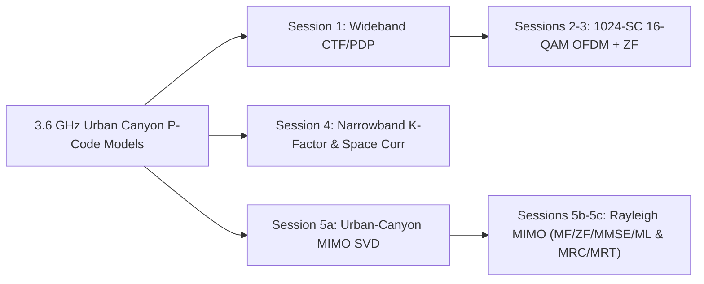
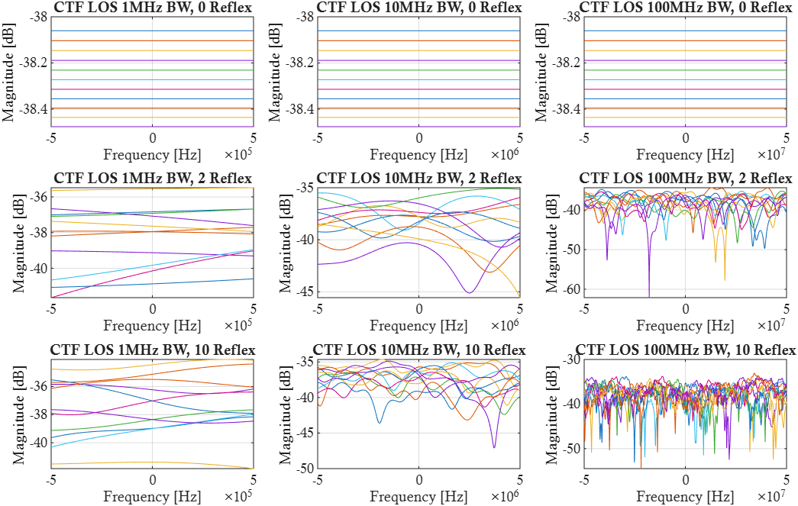
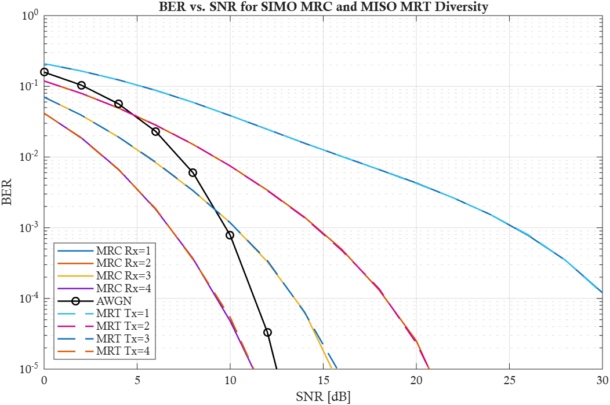

# Wireless Propagation, Wideband OFDM & MIMO Equalizers (3.6 GHz Urban Canyon)

Simulates 3.6 GHz urban street-canyon radio propagation, 1024-subcarrier 16-QAM OFDM transmission with sliding-autocorrelation synchronization and ZF equalization, and Rayleigh MIMO spatial multiplexing/diversity. Connects physical channel metrics (coherence bandwidth, RMS delay spread, Rician `K`-factor, coherence distance) directly to end-to-end BER performance.

## System & Processing Pipeline



1. **`src/propagation/session1_wideband_channel.m`** — Sweeps `B = [1, 10, 100] MHz` and wall reflections `rho = [0, 2, 10]` at `3.6 GHz` (`walls y = ±8 m`) to extract CTFs, `0.7`-threshold coherence bandwidth, CIRs, PDPs, and RMS delay spread `sigma_tau`.
2. **`src/propagation/session4_narrowband_fading.m`** — Maps narrowband local-area fading (`3.575` vs. `3.625 GHz`), fits Rician/Rayleigh PDFs and CDFs, computes `0.75`-threshold spatial coherence distance (`x, y`), and evaluates Power Angular Spectra.
3. **`src/ofdm/session2_3_ofdm_transceiver.m`** — Simulates `1024`-subcarrier `16-QAM` OFDM (`CP = 64`) over LOS & NLOS canyon channels using repeated training preambles (`BerSimulation_autoCorr.m`), LS CTF estimation, and single-tap ZF equalization (`-10..30 dB`).
4. **`src/mimo/session5a_mimo_channel_svd.m`** — Performs singular-value decomposition of `1 x 4` canyon MIMO channels for Y-oriented and X-oriented arrays across LOS and NLOS positions.
5. **`src/mimo/session5b_mimo_equalizers_rayleigh.m`** — Compares Matched Filter (`MF`), Zero-Forcing (`ZF`), `MMSE`, and exhaustive `ML` equalizers across `1 x 1` to `4 x 4` Rayleigh QPSK channels.
6. **`src/mimo/session5c_mimo_diversity_mrc_mrt.m`** — Evaluates `1 x N` SIMO `MRC` vs. `N x 1` MISO `MRT` diversity (`N = 1..4`) over Rayleigh fading against an uncoded QPSK AWGN reference.

## Key Results

Verified metrics recorded on MATLAB R2026b (`rng(0)` deterministic seeds):

| Module / Experiment | Condition / Configuration | Verified Metric |
| :--- | :--- | :--- |
| **Session 1: Wideband LOS (`rho = 10`)** | `B = 1 / 10 / 100 MHz` | Coherence BW: `1.00 / 10.00 / 7.62 MHz`; RMS `sigma_tau = 2355.1 / 304.8 / 84.6 ns` |
| **Session 4: Narrowband Fading** | `LOS` vs. `NLOS` | `K_los = 16.23` (`12.10 dB`) vs. `K_nlos = 0.0075` (`-21.24 dB`); `d_coh (x/y): 0.99/0.97 m` (LOS) vs. `0.01/0.01 m` (NLOS) |
| **Sessions 2-3: 1024-SC OFDM (`CP = 64`)** | LOS ZF equalized (`-10..30 dB`) | `BER: 0.3047 (-10 dB) -> 2.135e-3 (20 dB) -> 4.883e-5 (25 dB) -> 0 (30 dB)`; `CTF MSE: 9.870 -> 8.126e-4` |
| **Session 5a: Urban Canyon SVD** | Y-LOS vs. X-LOS | Dominant singular values: `3.302` (Y-LOS) vs. `3.897` (X-LOS) |
| **Session 5b: `4 x 4` Rayleigh MIMO** | `SNR = 20 dB` (`MF / ZF / MMSE / ML`) | `BER = 1.302e-1 / 4.844e-3 / 1.506e-3 / 0` |
| **Session 5c: Diversity Combining** | `SNR = 14 dB`, `Rx = 1 / 2 / 3 / 4` vs. AWGN | `MRC BER = 1.565e-2 / 1.406e-3 / 6.450e-5 / 0` vs. AWGN `2.682e-7` |


*Figure 1 (`session1_wb_fig01.png`): Wideband 3.6 GHz LOS Channel Transfer Functions showing increased frequency selectivity with bandwidth and reflections.*


*Figure 2 (`session4_nb_fig05.png`): Empirical small-scale fading envelopes fitted to Rician (`K = 12.1 dB`, LOS) and Rayleigh (`K = -21.2 dB`, NLOS) distributions.*


*Figure 3 (`session23_ofdm_fig03.png`): 1024-SC 16-QAM OFDM channel-estimation MSE and un-equalized vs. ZF-equalized BER over LOS and NLOS canyon channels.*


*Figure 4 (`session5b_eq_fig01.png`): `1 x 1` to `4 x 4` Rayleigh MIMO spatial-multiplexing BER across `MF`, `ZF`, `MMSE`, and exhaustive `ML` detection.*


*Figure 5 (`session5c_div_fig01.png`): Overlapping `1 x N` SIMO `MRC` and `N x 1` MISO `MRT` BER curves (`N = 1..4`) demonstrating transmit/receive duality.*

## Repository Layout & Quickstart

```text
wireless-propagation-mimo-ofdm/
├── functions/                                   # Course .p urban-canyon binaries (excluded from MIT)
├── src/
│   ├── common/                                  # Mapping, demapping, OFDM frame builder & autoCorr kernel
│   ├── propagation/
│   │   ├── session1_wideband_channel.m          # Wideband CTF, CIR, PDP, RMS delay & coherence BW
│   │   └── session4_narrowband_fading.m         # Narrowband PDF/CDF fits, coherence distance & PAS
│   ├── ofdm/
│   │   └── session2_3_ofdm_transceiver.m        # 1024-SC 16-QAM OFDM transceiver & ZF equalization
│   └── mimo/
│       ├── session5a_mimo_channel_svd.m         # Urban-canyon MIMO channel SVD eigenmodes
│       ├── session5b_mimo_equalizers_rayleigh.m # Rayleigh MIMO MF / ZF / MMSE / ML equalizer BER
│       └── session5c_mimo_diversity_mrc_mrt.m   # SIMO MRC & MISO MRT diversity BER vs. AWGN
├── docs/figures/                                # Exported white-background figures (23 PNGs)
├── .gitignore
├── LICENSE
└── README.md
```

- **MATLAB & Toolboxes:** MATLAB R2020b+ (verified on R2026b) with **Communications Toolbox** (`bi2de`, `de2bi`), **Statistics and Machine Learning Toolbox** (`fitdist`, `ecdf`), **Signal Processing Toolbox** (`db`), and **Image Processing Toolbox** (`mean2`).
- **Entry-Point Run Order:**
  ```matlab
  run('src/propagation/session1_wideband_channel.m')
  run('src/propagation/session4_narrowband_fading.m')
  run('src/ofdm/session2_3_ofdm_transceiver.m')
  run('src/mimo/session5a_mimo_channel_svd.m')
  run('src/mimo/session5b_mimo_equalizers_rayleigh.m')
  run('src/mimo/session5c_mimo_diversity_mrc_mrt.m')   % Longest diversity sweep (~92 s)
  ```
- **Runtime Notes:** Observed runtimes on default settings: `session5a` (`~5 s`), `session5b` (`~9 s`), `session2_3` (`~11 s`), `session1` (`~26 s`), `session4` (`~46 s`), and `session5c` (`~92 s`).
  > [!WARNING]
  > Both `session5b` and `session5c` use fast default sample counts (`numSymbols = 2e3` and `2e4, nb_real = 200`); increasing them to the full high-sample report configuration (`5e4` symbols, `0:2:40 dB`, `1000` realizations noted in script headers) takes roughly `3–10 minutes`.

## Dependencies & License

- **Proprietary Course Binaries (Excluded from MIT):** The 7 obfuscated `.p` files under `functions/` (`getGamma.p`, `getMPChannel.p`, `getNarrowBand.p`, `getNarrowBandMIMO.p`, `getWideBand.p`, `get_Prx.p`, `ucm_getRayInfo.p`) are instructor-provided academic models retained solely as runtime dependencies so the simulations execute out-of-the-box. As stated in [LICENSE](LICENSE), they are **explicitly excluded from the MIT License**.
- **License:** All original `.m` scripts in `src/` are distributed under the [MIT License](LICENSE) (`Copyright (c) 2026 Mathis Melki`).
